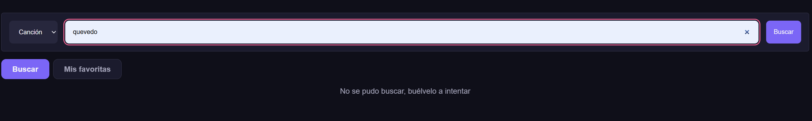

Children: es como un hueco que dejas en un componente para luego rellenarlo.
En tarjeta donde en la pestaña de busqueda pone el boton de puntuar, en favoritos se sustuuye por la nota y el comentario
Esto es porque en resultadoos pasamos onElegir y nada más y en listaFav no pasamos el parametro pero si que introducimos la nota y el comentario 

